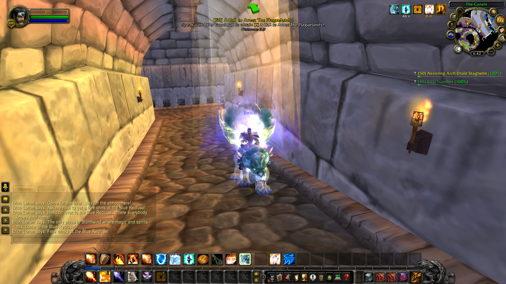

# Addons do Solo Realm e hospedagem local

Este guia cobre os addons instalados por este kit no cliente **World of Warcraft
Wrath of the Lich King 3.3.5a, build 12340**, os módulos de servidor de que
dependem e a configuração para jogar em um reino hospedado no **mesmo PC**.
O perfil padrão usa `127.0.0.1`: ele não configura acesso pela internet ou pela
rede de outros computadores.

## O que cada addon faz

| Pasta em `Interface\AddOns` | Origem | Função | Servidor necessário |
| --- | --- | --- | --- |
| `SoloRealmAddons` | `addons/SoloRealmAddons` deste kit | Loja de Ouro, Teletransportes e reset gratuito de talentos. | `mod-wow-teleporter` compilado com o servidor; NPCs da loja e do teletransporte exigem o SQL do módulo. |
| `HeraldWotLK` | `addons/HeraldWotLK` deste kit | Painel de questing com ícone de águia no minimapa e comando `/herald`. | `mod-playerbots` com o patch `patches/playerbots-herald.patch`. |
| `MultiBot` | Repositório `MultiBot-Chatless`, baixado pelo instalador | Comandos e interface para controlar Playerbots. | `mod-playerbots` e `mod-multibot-bridge`. |
| `DungeonClear` | Repositório `mod-dungeon-clear-addon`, baixado pelo instalador | Controles para a atividade de dungeon com bots. | `mod-dungeon-clear` e `mod-playerbots`. |
| `AltBot` | Repositório `AltBot`, baixado pelo instalador | Modos Quest e Farm para bots vinculados ao personagem mestre. | `mod-playerbots`. |

Os três recursos de `SoloRealmAddons` são **um único addon**. As antigas pastas
`SoloShop`, `SoloTeleport` e `SoloRealm` não são necessárias. O instalador
guarda cópias delas em `servidor/addon-backups` ao instalar o addon unificado.
Os demais addons que alguém tenha colocado no cliente, como interfaces ou
medidores de combate, ficam fora da instalação deste kit.

## Comandos e menu

| Recurso | Como abrir | O que acontece |
| --- | --- | --- |
| Loja de Ouro | `/shop`, botão **Loja de Ouro** no menu `Esc` ou atalho em **Teclas → Solo Realm Addons** | Mostra produtos, filtros de classe e nível, prévia e saldo. A compra só ocorre ao clicar em **Comprar**; o servidor confere preço, saldo e espaço na bolsa. |
| Teletransportes | `/teleport`, botão **Teletransportes** no menu `Esc` ou atalho em **Teclas → Solo Realm Addons** | Escolha continente e destino. O servidor verifica nível e condições do personagem. |
| Resetar Talentos | `/resettalentos` ou botão **Resetar Talentos** no menu `Esc` | Reseta gratuitamente apenas a especialização ativa. O botão pede confirmação; o comando age diretamente. Para a outra especialização, ative-a antes de repetir. |
| Herald WotLK | `/herald` ou ícone de águia no minimapa | Abre os controles **Iniciar**, **Pausar**, **Retomar**, **Parar** e **Ver estado**. |

O reset é recusado durante combate, voo, teletransporte ou morte. A loja e o
teletransporte também podem ser usados pelos NPCs configurados no reino. As
funções que enviam comandos ao servidor dependem da versão compilada do módulo;
copiar apenas o addon para o cliente não adiciona esses comandos ao servidor.

## Preparar o reino no próprio computador

1. Obtenha separadamente um cliente 3.3.5a build 12340. A pasta escolhida deve
   conter `Wow.exe` e `Data`. O cliente e seus arquivos de jogo não fazem parte
   deste repositório.
2. Prepare Windows, Git, Visual Studio 2022 com C++, CMake, MySQL 8.4 LTS,
   OpenSSL 3.x e Boost compatível, conforme [Preparar o Windows](../docs/01-preparar-o-windows.md).
3. Na raiz do kit, abra `Abrir-SoloRealm.vbs` ou `SoloRealm.exe`, selecione a
   pasta do cliente e use **Instalação completa**. O fluxo baixa as fontes
   fixadas, compila o servidor, extrai dados do cliente, configura MySQL e o
   reino, instala os addons e valida o perfil.
4. Use **Iniciar servidor** no launcher. Ele prepara o MySQL e inicia
   `authserver` e `worldserver`. Aguarde os dois consoles indicarem que o reino
   está pronto.
5. No console do `worldserver`, crie uma conta normal:

   ```text
   .account create SEU_LOGIN SUA_SENHA
   ```

6. Faça uma cópia de segurança de `Data\enUS\realmlist.wtf` (ou do diretório do
   idioma do seu cliente) e deixe a linha de conexão assim:

   ```text
   set realmlist 127.0.0.1
   ```

7. Abra `Wow.exe`, entre com essa conta e selecione **Reino Local**. Na tela de
   personagens, confira que `Solo Realm Addons` e `Herald WotLK` estão
   habilitados. Reinicie o cliente depois de instalar ou atualizar addons.

O mesmo fluxo pode ser iniciado no PowerShell, na raiz do kit, com:

```powershell
scripts\instalar.ps1 -ClientPath 'E:\Jogos\wow'
scripts\06-iniciar-servidor.ps1
```

Substitua `E:\Jogos\wow` pela pasta real que contém `Wow.exe`. Para instalar
somente os addons depois de uma compilação já pronta:

```powershell
scripts\05-instalar-addons.ps1 -ClientPath 'E:\Jogos\wow'
```

Use `-Only SoloRealmAddons,HeraldWotLK` para copiar apenas esses dois addons.
O instalador preserva as versões anteriores em `servidor/addon-backups`. Após
alterar o código C++ de `mod-wow-teleporter` ou outro módulo, execute novamente
`scripts\02-compilar-servidor.ps1` com o servidor parado e reinicie o reino.
Após alterar somente Lua/XML/TOC, reinstale o addon e reinicie o cliente.

## Patch visual de auras do cliente

As auras adicionais da imagem abaixo vêm de um **patch MPQ do cliente**, e não
dos addons Lua da tabela. Na instalação local usada para esta captura, o arquivo
ativo está em:

```text
E:\Jogos\wow\Data\enUS\patch-enUS-7.MPQ
```

O arquivo corresponde ao build local documentado em
`E:\Jogos\wow\work\arcane-aura\README.md`. Ele altera dados visuais de magias
no cliente `enUS`; não modifica as regras de talentos ou de buffs no servidor.
O patch MPQ e os dados do cliente não são distribuídos por este repositório.
Se você usar esse patch em sua própria cópia do cliente, feche o jogo antes de
substituí-lo, guarde uma cópia do arquivo anterior e só então reabra o jogo.
Os arquivos `patch-enUS-4.MPQ` a `patch-enUS-6.MPQ` nessa instalação são versões
anteriores do mesmo trabalho. Consulte o README local do patch para detalhes e
reversão. A captura mostra o resultado visual no jogo; ela não confirma, por si
só, qual arquivo específico foi carregado naquela sessão.



## Operação e ajuda

- Se o reino não aparecer, confirme que MySQL, `authserver` e `worldserver`
  iniciaram sem erro, que `realmlist.wtf` aponta para `127.0.0.1` e que o cliente
  é 3.3.5a build 12340. Consulte os logs em `servidor/run/startup-logs`.
- Se um addon não aparecer, confira a pasta em `Interface\AddOns`, o arquivo
  `.toc`, a caixa **AddOns** na seleção de personagens e reinicie o cliente.
- Se `/resettalentos`, `/shop` ou `/teleport` não forem reconhecidos, confira se
  `mod-wow-teleporter` foi copiado e compilado, se o servidor foi reiniciado e
  se as atualizações SQL dos NPCs foram importadas.
- Para desligar, use `server shutdown 1` no console do `worldserver`, feche o
  `authserver` e siga [Operação, backup e atualização](../docs/04-operar-e-proteger-dados.md).
- Antes de atualizar fontes ou bancos, faça backup pelo launcher ou por
  `scripts\07-backup.ps1` com o servidor encerrado.

Veja também o [guia principal](../README.md), [Configurar e jogar](../docs/03-configurar-e-jogar.md),
[Herald WotLK](../docs/06-herald-wotlk.md) e [downloads e licenças](../docs/05-downloads-e-licencas.md).
